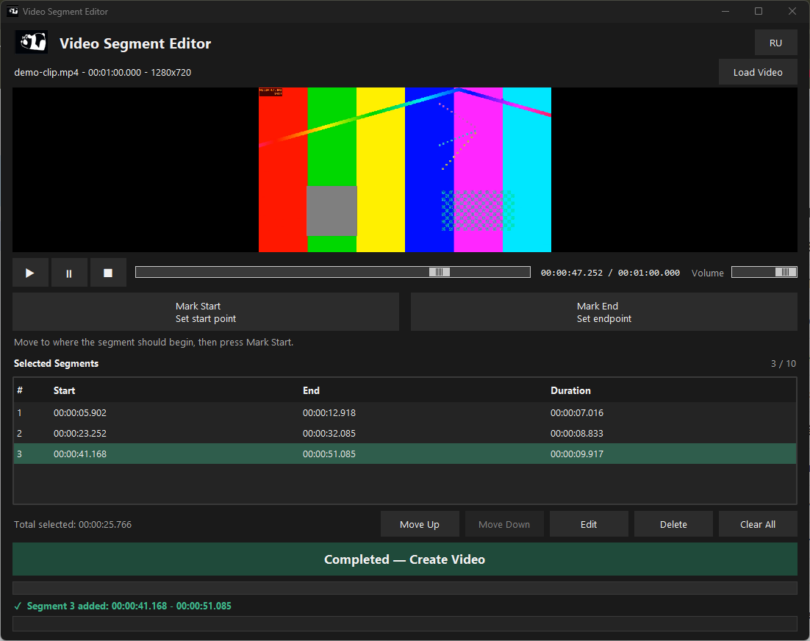
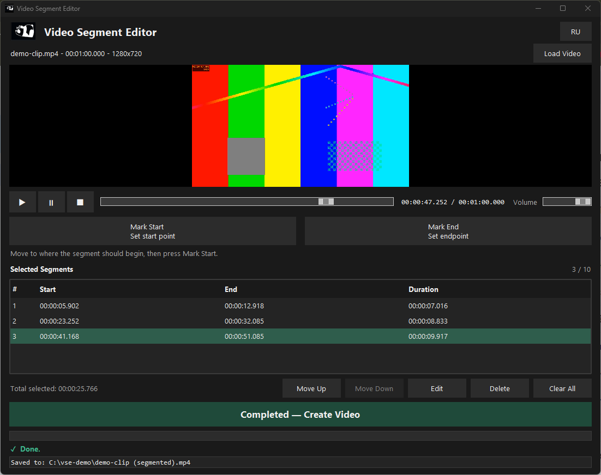

# Video Segment Editor

A small Windows desktop tool that cuts the parts you want out of a video and joins them into one new MP4.
Load a video, play it, mark up to 10 start/end segments, put them in the order you want, press one button.
**The original file is never changed.**

It is a segment cutter, not a general video editor: no transitions, filters or text.





## Contents

- [Overview](#overview)
- [Features](#features)
- [Requirements](#requirements)
- [Install and run (users)](#install-and-run-users)
- [How to use it](#how-to-use-it)
- [Supported and converted formats](#supported-and-converted-formats)
- [Measured limits](#measured-limits)
- [What it cannot do](#what-it-cannot-do)
- [Troubleshooting](#troubleshooting)
- [FAQ](#faq)
- [Privacy](#privacy)
- [Run from source (developers)](#run-from-source-developers)
- [Tests](#tests)
- [Build the release zip](#build-the-release-zip)
- [Build the Setup program (exe)](#build-the-setup-program-exe)
- [Project layout](#project-layout)
- [License](#license)
- [Acknowledgements](#acknowledgements)

## Overview

You load one video, watch it inside the window, and press **Mark Start** and **Mark End** for every part you want to
keep (up to 10 parts, called segments). You can reorder, edit or delete the segments, then press **Create Video**.
The program cuts every segment exactly at the frame you chose, joins them in the order of the table and saves one new
file next to the original: `<name> (segmented).mp4`. Before it says "Done" it checks the new file (picture, sound,
number of audio tracks, frame count, length).

Typical uses: keep the good minutes of a long recording, cut the dull parts out of a lecture or a match, make a short
clip from a phone video, put the best moments in a new order.

Design decisions, in short: the program always re-encodes (exact cuts matter more than speed), never touches the source
file, never overwrites an existing file, does all the slow work in a background thread so the window never freezes,
and works without the preview player (VLC) by letting you type the times.

## Features

- Embedded playback (VLC) with play, pause, stop, seek bar and volume (tooltips on the symbol buttons).
- Mark Start / Mark End, or type times by hand (`1:05`, `65` or `00:01:05.250`). Times are shown as
  hours:minutes:seconds, e.g. `00:01:05.250`.
- Up to 10 segments; edit, delete, clear, move up/down; total length shown.
- Every run re-encodes (H.264, CRF 18, AAC, MP4, faststart, a keyframe about every 2 s), so each piece starts at
  the frame you chose. The pieces are joined without re-encoding.
- Output next to the source: `<name> (segmented).mp4`, then `(segmented 2)`, ... Never overwrites; the source is read-only.
- The result is verified (picture, audio tracks, length, frames, A/V end time) before "Done" is shown.
- Background processing with a progress bar and a **Cancel** button (with a confirm question). After a failure or
  a cancel the temporary folder is kept and an **Open folder** button opens it.
- Status line with levels (info, ok, warning, error) and a symbol; themed dialogs; dark title bar.
- Scales with Windows display scaling (100% to 200% checked by emulation; see the checklist for what is not verified on a real display).
- English and Russian interface (button in the header, choice is remembered).
- Works without VLC (no preview; type the times by hand).
- Nothing is uploaded and the program itself never uses the network (see [Privacy](#privacy)).

## Requirements

- Windows 10 or 11 (64-bit).
- Python 3.11 or newer (the launcher can install it with winget; not needed for the Setup program).
- FFmpeg and FFprobe (required to create videos). The program searches PATH, the winget folders of the user,
  `Program Files\ffmpeg\bin` and `C:\ffmpeg\bin`. HDR conversion needs a build with `zscale` and `tonemap`
  (the winget build `Gyan.FFmpeg` has them).
- VLC media player (optional, for the preview). Python and VLC must both be 64-bit.
- For 4K video about 4.4 GB of free memory and about three times the size of the new video in free disk space.
- An internet connection only for the first start (to install the programs above); afterwards it works offline.

The launcher keeps its private Python environment, settings and log under `%LOCALAPPDATA%\VideoSegmentEditor`.

## Install and run (users)

There are two ways. Both need no administrator rights for the program itself.

### Way B: the release zip and the launcher

1. Open the **Releases** section of this repository (right-hand side of the page) and download
   `VideoSegmentEditor.zip` from the newest release.
2. Unzip it into a folder of your own (for example `Documents\Video Segment Editor`). Do not run it from inside the zip.
3. Double-click `VideoSegmentEditor.bat`. Windows may show a blue window "Windows protected your PC", because the
   launcher is not digitally signed: click **More info**, then **Run anyway** (only for a file from a source you trust).

On the first start the launcher first checks the whole computer: Python 3.11+, FFmpeg and VLC. If anything is
missing it shows **one screen** listing everything missing with its approximate size (Python 3.12 about 25 MB,
FFmpeg about 100 MB, VLC about 40 MB) and asks **one** Y/N question. On Y it installs all of it with `winget`
without further questions, then checks again by itself (no need to close the window after Python is installed).
This can take several minutes. Windows may show one permission window for VLC: click **Yes** (**No** means VLC is
not installed and there is no video preview).
Then it creates a private Python environment and installs `python-vlc`. Without `winget`, or on N, it prints plain
instructions for installing by hand (Python is required; without FFmpeg or VLC the program still starts). The black
window closes by itself when all went well; it waits for a key only when it printed a note or a problem. The next
start takes a few seconds. The full guide, with the by-hand steps for FFmpeg, is `README.txt` inside the zip.

`VideoSegmentEditor.bat /check` (in PowerShell: `.\VideoSegmentEditor.bat /check`) only reports what is installed
and installs nothing.

### Way A: the Setup program

`VideoSegmentEditor-Setup.exe` (a separate file, not in the zip) installs a self-contained build for the current user
only, with no Python needed and no administrator rights, into `%LOCALAPPDATA%\Programs\Video Segment Editor`.

1. Double-click the file. Windows may show the blue "Windows protected your PC" window (the file is unsigned):
   **More info**, then **Run anyway** (only for a file from a source you trust).
2. Accept the licence, keep or change the folder, optionally tick the desktop icon (empty by default).
3. Setup checks for FFmpeg and VLC. If they are missing, one page, "Programs the editor needs", lists them with
   their sizes and says that Setup installs them for you (no tick box, no question: click Next, then Install). After
   copying the program Setup installs them with `winget`. This step can take several minutes and the Setup window may
   look frozen meanwhile ("Installing FFmpeg. ..."). Windows may show one permission window for VLC: click **Yes**.
   Without `winget` the page says so, installs nothing and gives the addresses for installing by hand.
4. Start **Video Segment Editor** from the Start menu. Setup also adds a "Video Segment Editor - Read me" entry.

Silent install: `VideoSegmentEditor-Setup.exe /VERYSILENT` installs the program and, by default, a missing FFmpeg and
VLC too; add `/NOINSTALLMISSING` to install the program only (`/INSTALLMISSING=1` is still accepted and does nothing;
someone must still click **Yes** in VLC's permission window). Setup was tested
on the development PC only. See [Build the Setup program](#build-the-setup-program-exe).

### Updating and removing

- **Update:** run the newer Setup file (it installs over the old program), or unzip the newer zip into the same folder
  (the launcher updates its private environment by itself). Your videos and your language choice are not affected.
  The program never checks for updates on its own.
- **Remove, Setup version:** Windows Settings > Apps > Installed apps > Video Segment Editor > Uninstall.
- **Remove, zip version:** delete the folder you unzipped into.
- **Both:** the program's own data stays in `%LOCALAPPDATA%\VideoSegmentEditor` (`venv\` private Python environment,
  `settings.json` language choice, `app.log` log, `work\` leftovers of failed or cancelled runs). Delete that folder
  to remove everything. The videos the program made are yours and are never deleted.
- FFmpeg, VLC and Python are separate programs and stay installed. To remove them: Windows Settings > Apps, or
  `winget uninstall Gyan.FFmpeg`, `winget uninstall VideoLAN.VLC`, `winget uninstall Python.Python.3.12`.

## How to use it

1. **Load Video**: choose an MP4, MOV, AVI or MKV file (or "All files" to try another type). The line above the video
   shows name, length and picture size.
2. **Play, Pause, Stop** (hold the mouse over a symbol for its name), the long slider seeks, the small slider is the
   volume.
3. At the point where a segment should begin press **Mark Start** (the button turns green and shows the time).
4. At the point where it should end press **Mark End**. The segment appears in the table "Selected Segments" and the
   counter shows e.g. `3 / 10`. Mark End without Mark Start gives "Press Mark Start first, then Mark End.".
5. Repeat. At 10 segments the program says "Limit of 10 segments reached. Delete one to add another."
6. Fix the list with **Move Up / Move Down** (the new video follows the table order), **Edit** (type exact times;
   Enter or a double-click on a row also opens it), **Delete** (or the Delete key) and **Clear All** (asks first).
   Short forms for typed times: `1:05` is 1 minute 5 seconds, `65` is 65 seconds.
7. **Create Video**. A window shows the number of segments, the total length, the output file name and folder, and, when
   needed, "What will change in the new video:" (see the table below). Confirm with **Create Video**.
8. A progress bar shows "Cutting segment 2 of 3", "Joining the segments", "Checking the finished video". The
   **Cancel** button next to it stops the work (it asks first; temporary files are kept).
9. The status line shows **Done.** and below it **Saved to: ...** with the full path of the new file.

The language button at the top right (RU / EN) switches the whole interface at once, without losing the video or the
segments. Without VLC the video area says "VLC is not installed, so the video preview is switched off." and a small
form lets you type the start and end times and press **Add segment**.

## Supported and converted formats

Input: whatever FFmpeg and FFprobe can read (the file window lists MP4, MOV, AVI, MKV and "All files"); the preview needs
a format VLC can play. Output: always MP4, H.264 video, AAC audio.

| Source | What the program does |
|---|---|
| HDR (HDR10 / PQ, HLG) | tone-mapped to normal SDR BT.709 (mobius); assumes a 1000-nit master, brighter highlights clip; HDR information is not kept |
| 10-bit, 4:4:4, full-range, RGB | converted to 8-bit 4:2:0 limited range, dithered, colour tags written |
| Interlaced | deinterlaced (bwdif), same frame rate |
| Odd width or height | cropped by 1 pixel |
| Several audio tracks | all kept, with language tags; bitrate by channel count (mono 96k, stereo 192k, 5.1 384k, 7.1 512k) |
| No audio | the new video has no audio; not an error |
| Subtitles, chapters | not kept (the confirm dialog says so) |
| Variable frame rate, rotated phone video | accepted; rotation applied |
| Some Dolby Vision files | carry no standard HDR information and are not recognised as HDR |

The Create dialog lists what will be converted for the loaded file.

## Measured limits

**Measured on one development laptop** (8-core, 15 W AMD Ryzen 7, 15 GB RAM, FFmpeg 9.0.1) with generated test clips.
Other computers differ: a faster desktop can be 2 to 3 times quicker, a 4-core computer 2 to 3 times slower. These are
measurements, not promises.

| What | Measured |
|---|---|
| Segments per video | 10 (a fixed rule) |
| Audio drift at joins | about 13 ms per junction, about 120 ms after 10 segments (measured before the last fix round, not repeated since) |
| Audio gap at a junction | 21 to 39 ms (sine-tone test); audibility on real speech or music was not tested |
| Speed, 1080p 25 fps | about 0.3 s per output second (3.4x real time); ten 10-second segments about 30 s |
| Speed, 4K 30 fps | about 1.3 s per output second (slower than real time); ten 10-second segments about 2 min |
| HDR conversion | about 2x slower (measured on a short 1080p clip) |
| Start-up per segment | about a quarter of a second |
| Memory | about 1 GB (1080p); about 3.6 GB working set, 4.4 GB peak (4K); does not grow with the segment count |
| Disk | about 3x the new video at once (work folder 2x, then the copy next to the source); free space of at least 200 MB needed |
| Output size | high-bitrate source: about the size of the selected part; low-bitrate source can grow (a 0.8 Mbit/s clip of about 5 MB became about 17 MB) |
| Cut accuracy | within one video frame (e.g. 40 ms at 25 fps) of the typed time |
| Verification tolerance | length within 0.5 s + 0.1 s per segment; A/V end within 100 ms + 30 ms per segment |
| Probe time limit | 60 s for reading a file |
| Cancel / close | Cancel usually stops in about a second; closing the window waits at most 5 s |
| Housekeeping | `app.log` rotates at 1 MB; work folders older than 7 days are removed at start |

Not tested: real HDR footage, a real 125/150% display, Windows Media Player playback of the result, the Russian wording
by a native reader, a clean computer without Python/FFmpeg/VLC/winget, 4K on a 4 GB computer.

## What it cannot do

More than 10 segments in one video; transitions, effects, text, several video tracks; audio-only editing or output;
a fast stream-copy mode (version 1 always re-encodes); keeping subtitles, chapters or HDR; choosing another folder,
file name, quality, codec or container; working on macOS or Linux; editing several videos at once; saving the segment
list for later (it is cleared, after asking, when you load another video).

## Troubleshooting

Messages are quoted as the English interface shows them. More are in the **Troubleshooting** section of `README.txt`.

| Symptom or message | What to do |
|---|---|
| Nothing happens on double-click | A blue "Windows protected your PC" window may be waiting (More info, Run anyway). Do not run it from inside the zip. Run it from a Command Prompt to keep the messages on screen. |
| `PROBLEM: main.py or requirements.txt was not found.` | Keep the launcher in the same folder as the other files; unzip the whole package. |
| `PROBLEM: the private Python environment could not be created.` | Start again; if it keeps failing reinstall Python and keep "tcl/tk and IDLE" ticked. |
| `PROBLEM: the program packages could not be installed.` | The first start needs the internet (python-vlc). Check the connection and start again. |
| Program closes at once | Read `%LOCALAPPDATA%\VideoSegmentEditor\app.log`. |
| `FFmpeg is not installed.` / window "FFmpeg is missing" | Run `winget install Gyan.FFmpeg` in a Command Prompt, or put `ffmpeg.exe` and `ffprobe.exe` in `C:\ffmpeg\bin`, then restart. |
| No preview: "VLC is not installed, so the video preview is switched off." | Install the 64-bit VLC from videolan.org. Meanwhile type the times by hand. |
| `This file could not be read as a video.` | The file is damaged or not a video. Try it in VLC. |
| `The video file is in use by another program or access is denied.` | Close the other program. |
| `There is not enough free space on drive C:. About N MB is needed but only M MB is free.` | Free space; about 3x the size of the new video must be free. |
| `Cannot save in this folder: it is read-only or not allowed.` | Copy the video to a folder you can write to (Documents, Desktop). |
| `The finished video has the wrong length ...` (or frames, audio tracks, sound lost) | The final check failed, so no false "Done" is shown. Try again; try another file. |
| `Segment N of M could not be cut correctly ...` | Check that segment's times; the source may have a broken timeline. |
| Status line shows `Cancelled.` or an error and a folder path | The temporary files are kept there (the "Open folder" button); they are deleted after 7 days. |
| A `... (segmented).mp4.part` file is left | Only if the window was closed during the final copy. It is not a video; delete it. |

## FAQ

1. **Does it change my original video?** No. It only reads it; the result is a new file next to it.
2. **Why is it slower than I expected?** It always re-creates the picture so each cut is exact (see [Measured limits](#measured-limits)).
3. **Can I use several video files at once?** No, one video per run.
4. **More than 10 segments?** Not in one run. Make a video of 10, load it and continue.
5. **Can I pick the output folder or name?** Not inside the program; rename or move the result in File Explorer.
6. **Is the new file bigger than expected?** It is encoded at a fixed high quality (CRF 18); low-bitrate sources can grow.
7. **Do I need VLC?** No, only for the preview. Without it you type the times.
8. **Does it work offline?** Yes, after the first start.
9. **Windows warns about the file. Is it a virus?** The launcher and the Setup program are not digitally signed, which
   is what the warning is about. Run them only if you trust where you got them. The source is in this repository.
10. **The sound is slightly late after many segments.** About 13 ms per junction; fewer, longer segments give less shift.
11. **My HDR video looks different.** HDR is converted to normal video so it looks right on ordinary screens.
12. **Are subtitles kept?** No, nor chapters.
13. **Can I stop the work?** Yes: Cancel. The original is untouched.
14. **Is it safe to let it install Python, FFmpeg and VLC?** They are the official free packages installed by `winget`;
    you are asked once and can say N and install them yourself.
15. **Which languages?** English and Russian; the button in the header switches.
16. **Where is the data stored?** `%LOCALAPPDATA%\VideoSegmentEditor`.
17. **How do I report a bug?** Use the Issues page of this repository: give the version, your Windows version, the exact
    message and the last lines of `app.log`. Do not attach the video.

## Privacy

Nothing is uploaded; there are no accounts, no tracking and no statistics. The program itself never uses the network.
Only other programs do, and only when you agree: `winget` downloads Python, FFmpeg and VLC, and `pip` downloads
`python-vlc` on the first start of the zip version. Clicking the VLC download link in the program opens your web browser.
The program stores only a language setting, a log (which can contain the path of a loaded video) and the temporary files
of failed or cancelled runs, all under `%LOCALAPPDATA%\VideoSegmentEditor`. The repository contains no personal data.

## Run from source (developers)

Get the source with the green **Code** button of this page (Download ZIP, or copy the address it shows and run
`git clone` with it). Then, in the project folder:

```
py -3 -m venv venv
venv\Scripts\python -m pip install -r requirements.txt
venv\Scripts\python main.py
```

Or just use `VideoSegmentEditor.bat`. Without VLC, set the environment variable `VSE_FORCE_NO_VLC=1` to simulate a
missing VLC.

## Tests

```
python -m unittest discover -s tests
```

444 tests (1 skipped without a special clip). The pipeline tests use real FFmpeg and FFprobe and are skipped with a
message when they are missing; the GUI tests drive the real window headlessly and need Tk. `docs/test-checklist.md`
lists the manual checks and what nobody has verified yet (real VLC mark at the end, real 125/150% display, real HDR
footage, Windows Media Player playback, Russian wording). A text change must keep the English and Russian
strings in step (the i18n parity tests check it).

## Build the release zip

```
powershell -NoProfile -ExecutionPolicy Bypass -File build_release.ps1 [-Dest <folder>]
```

Runs the tests, checks that the version in `README.txt` equals `APP_VER` in `main.py`, packages a fixed whitelist of
14 files (7 runtime `.py` files, `requirements.txt`, the launcher, `README.txt`, `LICENSE`, 3 files in `assets\`),
fails on any private or development file, checks the byte format of the launcher and of `README.txt`, and writes a
flat `VideoSegmentEditor.zip`. `-Dest <folder>` writes a trial build elsewhere. Windows PowerShell 5.1.

## Build the Setup program (exe)

```
powershell -NoProfile -ExecutionPolicy Bypass -File build_installer.ps1 [-Dest <folder>] [-Work <folder>]
```

Needs Python 3.11+ on PATH and [Inno Setup 6](https://jrsoftware.org/isinfo.php)
(`winget install -e --id JRSoftware.InnoSetup --scope user`). The script runs the tests, checks the version, builds a
PyInstaller **one-folder** build of `main.py` (windowed, with `assets\`, `python-vlc` and all modules) in a private
build environment, and wraps it with `installer\VideoSegmentEditor.iss` into `VideoSegmentEditor-Setup.exe`. Default
output folder is the same as for the zip; `-Dest` writes a trial build elsewhere; `-Work` keeps and reuses the build
folder. The installer files are not part of the release zip. The exe contains neither VLC nor FFmpeg.

## Project layout

| Path | Role |
|---|---|
| `main.py` | Entry point, `APP_VER` (the one place the version is defined), log redirect, DPI, taskbar id |
| `gui.py` | All widgets, theme, handlers, dialogs, Create Video flow |
| `i18n.py` | English and Russian strings, saved language choice |
| `create_flow.py` | Helpers for the Create Video flow (work folder, progress mapping, old-folder cleanup) |
| `segment_manager.py` | Segment list, all segment rules, time parsing and formatting |
| `video_player.py` | python-vlc wrapper |
| `video_processor.py` | Finds FFmpeg, probes, builds commands, cuts, joins, verifies |
| `VideoSegmentEditor.bat` | Launcher (Python, private environment, winget installs, `/check`) |
| `README.txt` | End-user guide shipped in the zip (plain text) |
| `requirements.txt` | `python-vlc` |
| `assets\` | Logo files |
| `build_release.ps1`, `build_installer.ps1`, `installer\` | Zip build, Setup build, Inno Setup script |
| `tests\` | unittest suite (not shipped) |
| `docs\` | Design notes, plans, `test-checklist.md`, screenshots (not shipped) |
| `LICENSE` | MIT licence |

## License

MIT License. Copyright (c) 2026 Michael Yeruhimovich. See the `LICENSE` file for the full text.

## Acknowledgements

This program only works because of the following free projects. They are separate programs with their own licences,
which apply to them and not to this program (they are not part of the zip; where unsure the licence is marked
"check upstream licence").

- [FFmpeg](https://ffmpeg.org) does all the cutting, probing and joining. Licensed under the LGPL 2.1 or later, or
  the GPL 2 or later, depending on how the build was made (the Gyan.FFmpeg builds installed by `winget` are GPL builds;
  check upstream licence of the build you use). Windows builds by [gyan.dev](https://www.gyan.dev/ffmpeg/builds/).
- [VLC media player](https://www.videolan.org/vlc/) by VideoLAN plays the preview. The player is under the GPL 2 or
  later, its libVLC engine under the LGPL 2.1 or later.
- [python-vlc](https://github.com/oaubert/python-vlc) connects Python to libVLC. LGPL 2.1 or later (check upstream licence).
- [PyInstaller](https://pyinstaller.org) builds the self-contained program for the Setup version. GPL 2 or later with
  an exception that lets the bundled program use any licence (check upstream licence).
- [Inno Setup](https://jrsoftware.org/isinfo.php) by Jordan Russell and Martijn Laan builds the Setup program. It is
  free software under its own licence (check upstream licence).
- [Python](https://www.python.org) and its `tkinter` toolkit (PSF licence) run the program.

This program was designed and tested by its owner and built with the help of
[Claude Code](https://claude.com/claude-code), an AI coding assistant by Anthropic.
